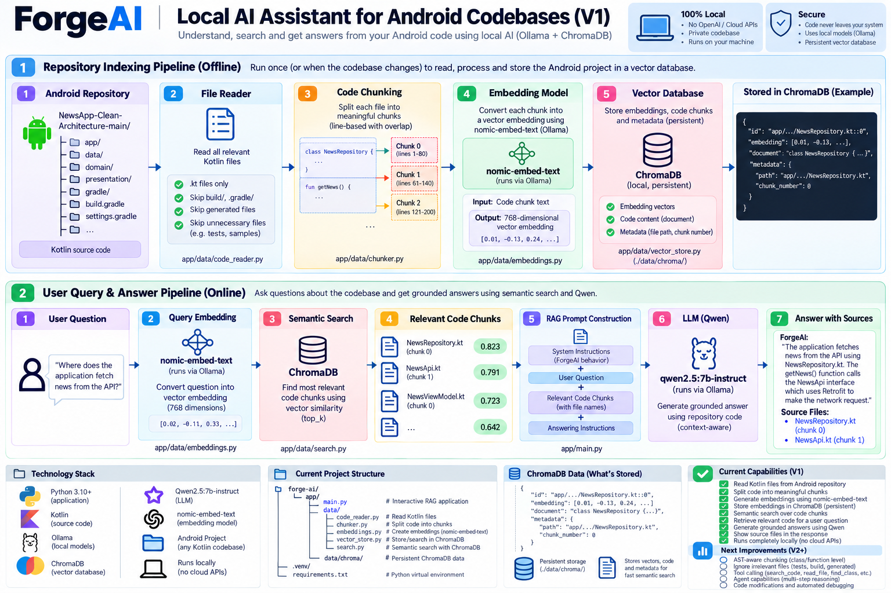

# ForgeAI V1



**A local AI-powered code assistant that helps developers understand and explore codebases.**

ForgeAI V1 uses a local language model, embeddings, and retrieval-augmented generation (RAG) to retrieve relevant code and help answer questions about a project.

## Features

- **Local AI inference** using Ollama
- **Semantic code search** using embeddings
- **Retrieval-augmented generation (RAG)** with ChromaDB
- **Code ingestion and chunking** for searching source files
- **Python-based architecture** designed for local development

## Architecture

1. Read source files from a codebase.
2. Split the source into smaller chunks.
3. Generate embeddings for semantic retrieval.
4. Store and retrieve relevant chunks using ChromaDB.
5. Use the retrieved context to help answer code-related questions.

## Tech Stack

- Python
- Ollama
- Qwen 2.5
- ChromaDB
- Embeddings with `nomic-embed-text`

## Prerequisites

- Python 3.12 recommended
- [Ollama](https://ollama.com/) installed and running
- Git

## Getting Started

### 1. Clone the repository

```bash
git clone https://github.com/pushpenmahawar/ForgeAI.git
cd ForgeAI
```

### 2. Create and activate a virtual environment

macOS or Linux:

```bash
python3 -m venv .venv
source .venv/bin/activate
```

### 3. Install dependencies

```bash
pip install -r requirements.txt
```

### 4. Download the local models

```bash
ollama pull qwen2.5:7b-instruct
ollama pull nomic-embed-text:latest
```

Make sure the Ollama service is running before starting ForgeAI.

### 5. Run ForgeAI

```bash
python -m app.main
```

Follow the prompts displayed by the application.

## Project Structure

```text
ForgeAI/
├── app/
│   ├── data/
│   │   ├── chunker.py
│   │   ├── code_reader.py
│   │   ├── embeddings.py
│   │   ├── indexer.py
│   │   ├── retriever.py
│   │   ├── search.py
│   │   ├── semantic_retriever.py
│   │   └── vector_store.py
│   └── main.py
├── assets/
│   └── forgeai-v1.png
├── requirements.txt
└── README.md
```

## Privacy

ForgeAI is designed to use a locally running language model. Review the configured source directories and any external services before processing private code. Do not commit API keys, credentials, virtual environments, local model files, or generated databases.

## Roadmap

- Improve code retrieval and answer quality
- Expand codebase exploration capabilities
- Build a tool-calling agent
- Add stronger validation and error handling

## Version

**V1 — Initial RAG-based code assistant**

ForgeAI is an evolving project exploring practical applications of local LLMs and RAG for software engineering.

## Author

**Pushpen Mahawar**

GitHub: [@pushpenmahawar](https://github.com/pushpenmahawar)
