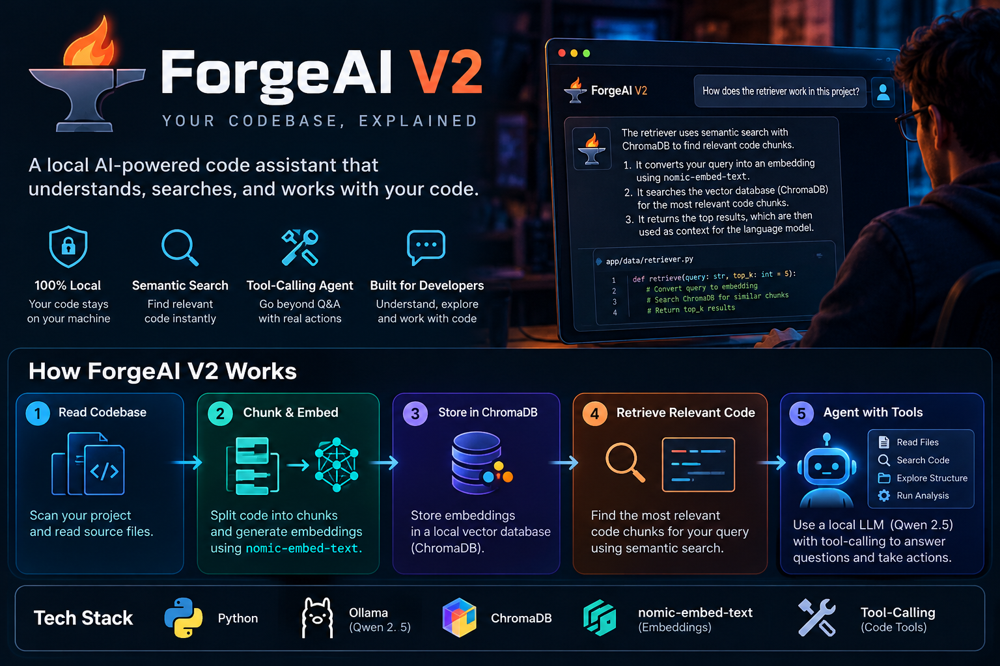

# ForgeAI V2



**A local AI-powered code assistant with semantic retrieval and tool-calling capabilities.**

ForgeAI V2 extends the original RAG-based code assistant with developer tools to help AI explore and understand source code.

## Features

- Local AI inference using Ollama and Qwen 2.5
- Retrieval-Augmented Generation (RAG)
- Semantic code search using embeddings
- ChromaDB vector storage and retrieval
- Code tools and tool registry
- Modular Python architecture

## Architecture

1. Read source files from a codebase.
2. Split source code into manageable chunks.
3. Generate embeddings using `nomic-embed-text`.
4. Store and retrieve relevant code using ChromaDB.
5. Provide relevant context to the local Qwen model.
6. Use available code tools to support developer workflows.

## Tech Stack

- Python 3.12
- Ollama
- Qwen 2.5
- ChromaDB
- `nomic-embed-text`

## Setup

Prerequisites: Python 3.12, Git, and [Ollama](https://ollama.com/).

Clone the repository:

```bash
git clone https://github.com/pushpenmahawar/ForgeAI.git
cd ForgeAI
```

Create a virtual environment and install dependencies:

```bash
python3 -m venv .venv
source .venv/bin/activate
pip install -r requirements.txt
```

Download the required models:

```bash
ollama pull qwen2.5:7b-instruct
ollama pull nomic-embed-text
```

Start Ollama if needed, then run ForgeAI:

```bash
ollama serve
python -m app.main
```

Check `app/main.py` for the actual startup flow and model configuration.

## Privacy

ForgeAI is designed for local development with Ollama. Keep `.env`, `.venv/`, and generated ChromaDB files out of version control.

## Version History

- **V1:** Initial RAG-based code assistant. See the [`v1.0.0` tag](https://github.com/pushpenmahawar/ForgeAI/releases/tag/v1.0.0).
- **V2:** Adds code tools and a tool-registry architecture.

## Author

Pushpendra Mahawar

Repository: https://github.com/pushpenmahawar/ForgeAI